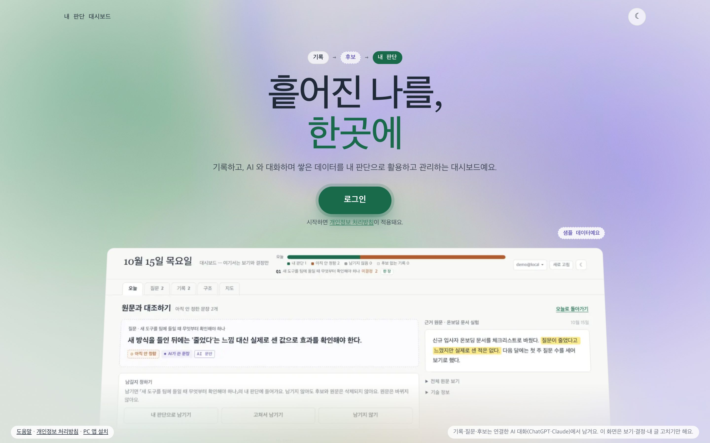
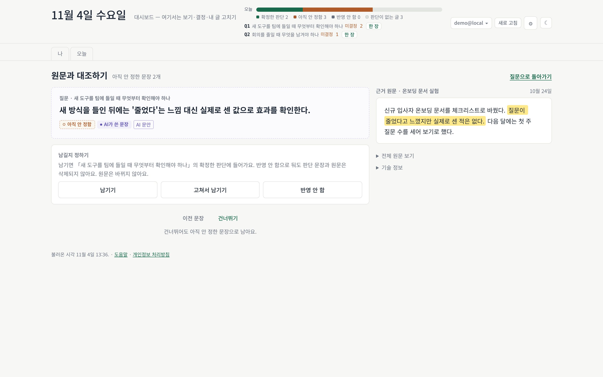
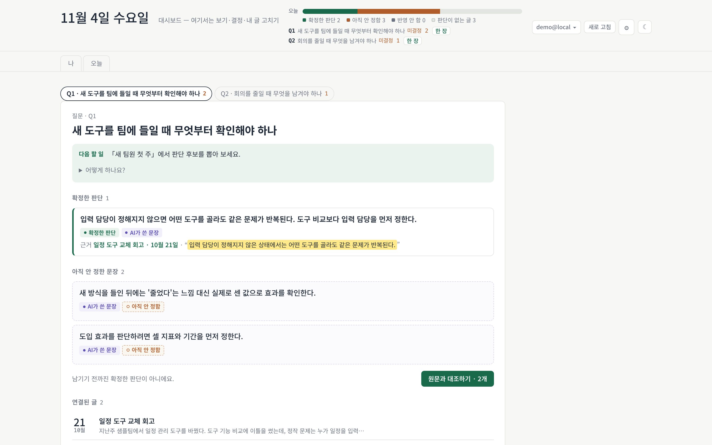

# My CRM

**내 글에서 판단을 뽑아 원문과 대조하고, 내가 남긴 판단만 쌓는 「내 판단 대시보드」.**

[웹](https://personal-mycrm.onrender.com/) &nbsp;·&nbsp; ChatGPT·Claude 구독으로 연결 &nbsp;·&nbsp; 서버는 모델을 부르지 않음

  

대화에서 겪은 일을 말하면 AI 가 그 말을 그대로 「내 글」로 남깁니다. AI 는 글에서 판단이 될 만한 문장을 「검토할 판단」으로 뽑고, 근거 구절을 원문에서 글자 그대로 가져옵니다. 남길지는 웹에서 원문과 나란히 놓고 내가 정합니다. 남긴 문장만 「확정한 판단」이 되고, 판단은 질문 밑에 쌓입니다.

<table>
  <tr>
    <td width="50%"></td>
    <td width="50%"></td>
  </tr>
  <tr>
    <td><b>원문과 대조하기</b> 검토할 판단과 근거 원문을 나란히 놓고 남길지 정합니다</td>
    <td><b>질문 한 장</b> 확정한 판단 · 아직 안 정한 문장 · 연결된 글</td>
  </tr>
</table>

스크린샷은 모두 가짜 샘플 데이터입니다.

## 설치

| 어디서 | 주소 |
| --- | --- |
| 데스크톱 앱 | <https://personal-mycrm.onrender.com/download> |
| MCP 커넥터 | `https://personal-mycrm.onrender.com/mcp` |

Claude Code 는 `claude mcp add --transport http my-crm https://personal-mycrm.onrender.com/mcp` 뒤 `/mcp` 에서 로그인합니다. 처음 로그인하면 계정이 생기고, 같은 이메일이면 대화와 웹이 한 계정입니다. 연결과 첫 하루는 [09. 호스팅 판](guides/09-hosted-start.md), 화면의 말 뜻은 [10. 말 뜻](guides/10-words.md).

## 원칙

- **글은 말한 그대로.** 내 글은 다듬거나 요약하지 않고 저장합니다. 내가 고치라고 한 구절만 바뀌고, 고친 흔적이 남습니다.
- **근거는 원문 글자 그대로.** 검토할 판단의 근거 구절이 원문에 그대로 없으면 서버가 거절합니다. 남이 한 말은 판단으로 뽑지 않습니다.
- **확정은 나만.** AI 는 뽑기만 합니다. 남길지는 내가 원문과 대조해 정하고, 남긴 판단 문장은 덮어쓰지 않습니다.
- **API 키 없음.** 서버는 모델을 부르지 않습니다. 모델 비용은 내가 연결한 ChatGPT·Claude 구독에서 나갑니다.
- **사람은 별칭 하나.** 연락처·소속·그 사람의 말은 받지 않습니다. 표시 이름은 다른 사람과 운영자 화면에 보이지 않습니다.

처리하는 정보와 보관 기간은 [11. 개인정보 처리방침](guides/11-privacy.md).

## 라이선스

미정. 정해지기 전까지 [DECISIONS-PENDING.md](DECISIONS-PENDING.md) 「판매·정책」에 둡니다.
